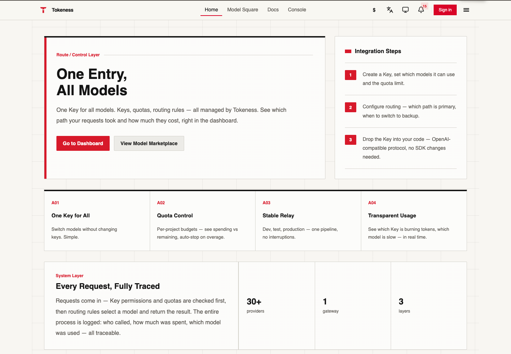
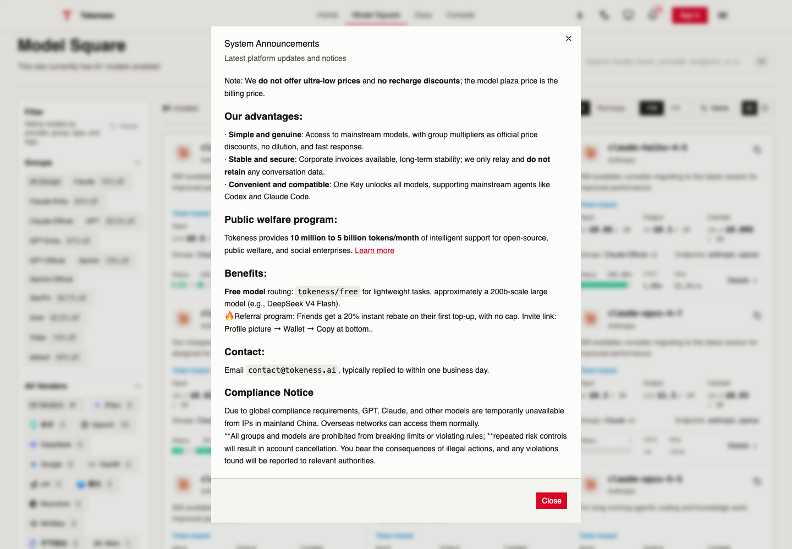
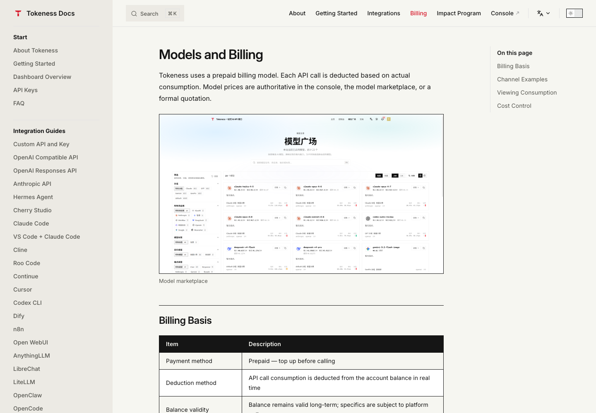

# Tokeness Review: One Key for Claude, Gemini and OpenAI-Compatible Apps

**Bottom line:** Tokeness is aimed at developers who switch models often. Claude, Gemini, image models, project keys, balance and usage logs live in one dashboard.

[Open Tokeness and check the current offer](https://tokeness.ai/sign-up?aff=36pK)

## Where Tokeness fits

Tokeness replaces the overhead of maintaining separate balances for several model vendors. A coding-only subscription may be simpler when one client and one model cover every workload.

Tokeness presents per-million-token prices in dollars; available wallet funding methods depend on the account checkout screen.

## Pricing and plan logic

The catalog separates input, output and cache-read pricing. Public examples include Claude Haiku 4.5 at $0.06 / $0.30 and Claude Sonnet 4.6 at $0.18 / $0.90 per million tokens; an image model is also listed per request.

Tokeness buyers should compare cache-read pricing alongside input and output, especially for repeated coding context.

## Funding the account

Tokeness uses prepaid wallet billing. Register, fund the wallet, select a model in the catalog and create a project key with a spending limit. Add balance in smaller intervals because unused-balance handling is restricted by the service terms.

[Create an account and view the live checkout](https://tokeness.ai/sign-up?aff=36pK)

## Claude Code, Codex and API setup

OpenAI-compatible clients use `https://n.tokeness.dev/v1`. For Claude Code, add an OpenAI Compatible provider in CC Switch with `https://n.tokeness.dev` and enable routing.

On Tokeness, project keys should separate human coding, scheduled automation and image requests because each has a different spend pattern.

## Recommended rollout

1. Shortlist Haiku, Sonnet and one backup model.
2. Fund a small prepaid wallet amount.
3. Create separate project and automation keys.
4. Configure CC Switch routing for Claude Code.
5. Compare output and cache-read spend after repeated tasks.

## FAQ

### Is Tokeness a replacement for an official API account?

Tokeness can replace several small model balances; keep vendor-direct access when upstream identity and support must be contractual.

### Should I use one key for every tool?

No. Tokeness project keys provide cleaner cache and model-level usage records when split by workflow.

### Which model should I test first?

Try Tokeness Haiku for routing and logging checks, then move daily coding to Sonnet if required.

### How do I avoid unexpected spend?

For Tokeness, restrict project models and compare cache reads after a repeated-context coding session.

## Verdict

Tokeness is aimed at developers who switch models often. Claude, Gemini, image models, project keys, balance and usage logs live in one dashboard. Tokeness replaces the overhead of maintaining separate balances for several model vendors. A coding-only subscription may be simpler when one client and one model cover every workload.

[Visit Tokeness and compare the live pricing](https://tokeness.ai/sign-up?aff=36pK)

Tokeness search terms

Tokeness review · Tokeness pricing · Tokeness signup · Claude Code API relay · Codex API gateway · AI API proxy

---

*Tokeness page checked November 19, 2026; recheck the live catalog and checkout before purchase.*
